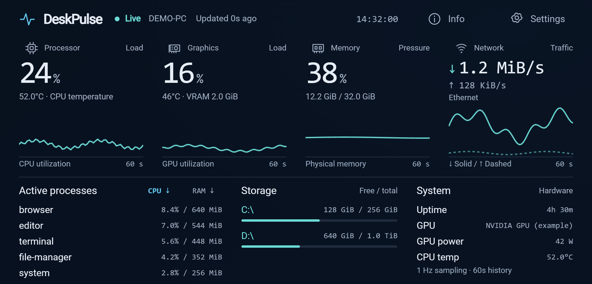
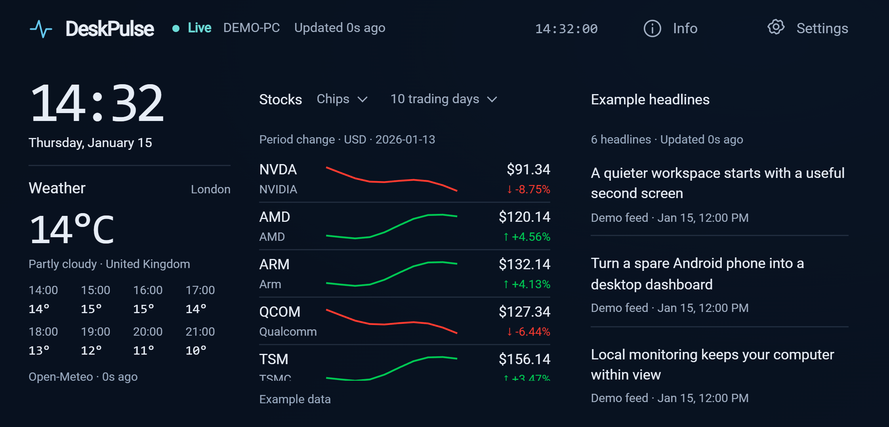
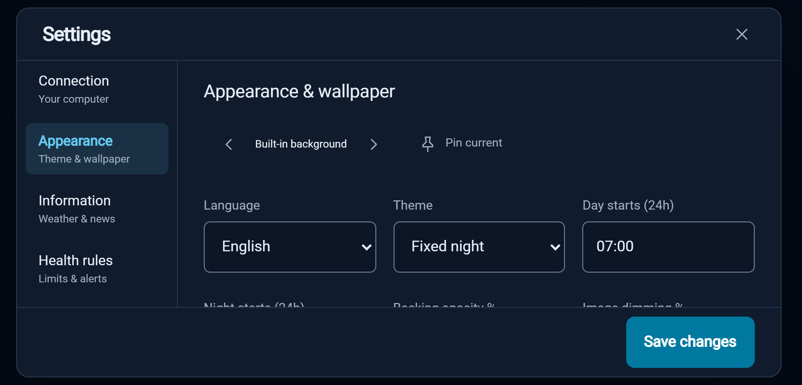

<div align="center">

# ⚡ DeskPulse

**Turn a spare Android phone into a dedicated PC monitor and desk display.**

**English** | [简体中文](README.zh-CN.md)

[](https://github.com/chzhangtud/DeskPulse/releases/download/v0.1.0/DeskPulse-0.1.0.apk)
[](https://github.com/chzhangtud/DeskPulse/releases/download/v0.1.0/DeskPulse-0.1.0-windows-x64.zip)

[v0.1.0 preview · Release notes and SHA-256 checksums](https://github.com/chzhangtud/DeskPulse/releases/tag/v0.1.0)

[](android/)
[](collector/)
[](collector/DeskPulse.Collector.csproj)
[](#configuration)

[🚀 Quick start](#quick-start) · [🖼️ Screenshots](#screenshots) · [⚙️ Configuration](#configuration) · [🤖 Agent deployment](docs/AGENT_DEPLOY.md)

</div>



## Features

- **Live monitoring:** CPU, NVIDIA GPU, physical memory, network rates, disk capacity, and separate CPU / RAM process rankings. One-second sampling with 60-second charts.
- **Independent information display:** clock, weather, daily US stock charts, and RSS headlines when the PC is offline. Monitoring resumes automatically when the connection returns.
- **Made for the desk:** immersive landscape layout, light and dark themes, scheduled theme changes, local wallpaper rotation, and English / Simplified Chinese support.
- **Private LAN pairing:** certificate-pinned HTTPS, single-use setup codes valid for ten minutes, and credentials encrypted with Android Keystore.
- **Optional temperature and startup support:** a signed driver enables CPU temperature readings; a Windows sign-in task can start the collector hidden and recover after a process exit.

Unsupported sensors display unavailable. CPU temperature requires PawnIO and an elevated collector. GPU sensors currently support NVIDIA.

## Screenshots

### An information display that works without the PC



### Themes, language, and wallpapers



These screenshots render the Android app's bundled HTML/CSS/JavaScript interface at the same landscape aspect ratio. Host, hardware, process, stock, weather, and headline values are example data, not a real device or live market data.

## Quick start

### Install a downloaded build

1. Download the **Windows x64 ZIP** above and extract the entire archive into one folder. Run `DeskPulse.Collector.exe`; no .NET installation is required.
2. In an administrator PowerShell window opened in that folder, run `./Allow-Lan.ps1 -Program "$PWD/DeskPulse.Collector.exe" -LocalAddress 192.168.1.20`, replacing the example address with the collector's printed LAN address.
3. Download the **Android APK** above and install it on an Android 10+ phone. This preview uses a development signing certificate.
4. Privately transfer the collector's `state/pairing.txt` to the phone. In **Settings → Connection → Import setup file**, import it and tap **Pair computer** within ten minutes of starting the collector.

Keep the PC and phone on a reachable LAN. Preserve the collector's `state/` folder when upgrading. The release includes `SHA256SUMS.txt`; use `Get-FileHash -Algorithm SHA256` to verify either download.

### 1. Build from source

Requirements: Windows 10/11 x64, Git, .NET 8 SDK, JDK 17+, Android SDK Platform / Build-tools 35, and Node.js 18+. Python 3.10+ is needed for collector integration tests. Set `ANDROID_HOME` and `JAVA_HOME` to your SDK / JDK, or pass their paths as build script parameters.

```powershell
git clone git@github.com:chzhangtud/DeskPulse.git
cd DeskPulse
./scripts/Build.ps1
```

For installation without build tools, use the release downloads above. Building from source creates these local outputs:

| Output | Purpose |
| --- | --- |
| `artifacts/android/DeskPulse-0.1.0.apk` | Install on an Android 10+ phone |
| `artifacts/collector/` | Complete Windows collector directory |
| `artifacts/DeskPulse-0.1.0-windows-x64.zip` | Windows distribution without private pairing state |

The script produces a development-signed APK. Configure your own release signing identity before distributing a production APK. The Windows collector is self-contained and needs no separately installed .NET runtime.

### 2. Start the collector and allow LAN access

In a regular PowerShell window:

```powershell
./scripts/Start-Collector.ps1
```

The collector prints its listening address. In an administrator PowerShell window, configure the scoped firewall rule below. Replace the example address with the actual LAN address printed by the collector.

```powershell
./scripts/Allow-Lan.ps1 -Program "$PWD/artifacts/collector/DeskPulse.Collector.exe" -LocalAddress 192.168.1.20
```

The PC and phone must be able to reach each other on the LAN. Do not configure public port forwarding for this service.

### 3. Install the Android app and pair

Transfer the APK to the phone and install it, or use an authorized USB debugging connection:

```powershell
adb install -r artifacts/android/DeskPulse-0.1.0.apk
adb shell am start -W -n io.deskpulse.app/.MainActivity
```

Privately transfer `artifacts/collector/state/pairing.txt` to the phone. Open **Settings → Connection → Import setup file**, import the file, and tap **Pair computer**. You can also paste its setup string. The code expires ten minutes after collector startup and works once. Existing paired phones retain access across restarts.

See the [installation guide](docs/INSTALL.md) for sign-in startup, CPU temperature, upgrades, and troubleshooting.

## Configuration

Change display settings in the app's **Settings** panel without editing source files.

| Section | Options / defaults |
| --- | --- |
| Connection | Import a setup code or change the collector address |
| Appearance | English / Simplified Chinese; dark theme by default; scheduled boundaries at 07:00 / 19:00 |
| Wallpaper | Local folder, rotation, pinning, cover / contain; five-minute rotation by default |
| Appearance | Backing opacity 86%, image dimming 30% |
| Information | London as the example weather city; configurable Ars Technica RSS feed |
| Stocks | Semiconductors / Tech / Other; defaults to semiconductors and 10 trading days; also supports 5 days and 1/3/6 months |
| Health rules | Memory 85/95%; CPU temperature 85/95°C; GPU temperature 80/88°C; disk free space 15/5% |
| Active processes | Top five processes ranked independently by CPU or RAM |

To select the collector address and port explicitly:

```powershell
./scripts/Start-Collector.ps1 -ListenAddress 192.168.1.20 -Port 9443
```

You can also run the EXE directly and use `--state` to select a private state directory. The phone gets the port from the setup code. After changing it, import an updated setup code and update the firewall rule.

Weather and news refresh directly from the phone every 15 minutes. Stocks show daily closes from completed sessions, with source and session date. Successful caches remain available without internet access; a fresh installation without a cache displays unavailable. Stock percentages follow the selected period and use unadjusted prices excluding dividends.

## Agent deployment

Read [AGENTS.md](AGENTS.md), then follow the [agent deployment runbook](docs/AGENT_DEPLOY.md): check the environment → build → configure startup / firewall → install and pair privately → verify. The runbook includes acceptance criteria and an upgrade process that preserves pairing state.

## Development and verification

```powershell
node --test tests/core.test.cjs tests/i18n.test.cjs tests/stocks.test.cjs
dotnet build collector -c Release
python tests/collector_integration.py
./android/gradlew.bat -p android assembleDebug lintDebug
```

Node tests require no device or network. Collector integration tests use an isolated temporary loopback instance. Real-device outage tests toggle phone Wi-Fi and restart the test collector; read the [test instructions](docs/INSTALL.md#tests) first.

## Project structure

```text
android/       Android app and its bundled display interface
collector/     Windows sensors and HTTPS API
scripts/       Build, startup, firewall, sensor driver, and sign-in tasks
tests/         Logic, collector, and real-device checks
docs/          Installation, agent deployment, architecture, and screenshots
licenses/      Original third-party license texts
```

## Privacy and dependencies

Pairing codes, client state, certificates, logs, build outputs, and internal plans are excluded from Git. Keep `state/`, setup strings printed in the console, and screenshots containing real host information out of public issues. The `/health` endpoint returns the machine name to LAN callers; telemetry also includes hardware, process, and network adapter information.

Android has no third-party runtime library dependencies. Windows uses LibreHardwareMonitor. See [third-party notices](THIRD_PARTY_NOTICES.md) for optional drivers and weather, news, and market data sources. Third-party licenses apply to their respective components. See the [architecture guide](docs/ARCHITECTURE.md) for implementation details and trust boundaries.
